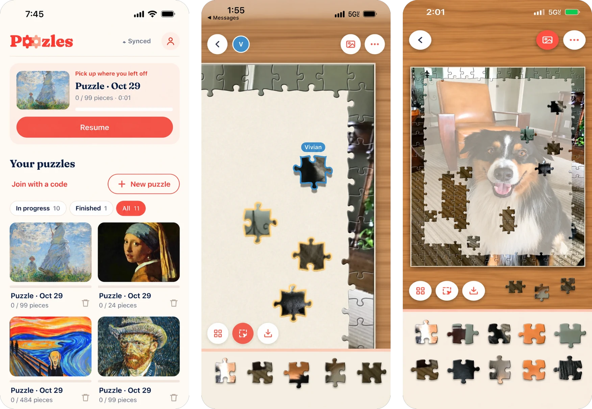

<p align="center">
  
</p>

<h1 align="center">Poozles</h1>

<p align="center">
  <strong>Build puzzles with friends.</strong><br>
  Turn any photo into a jigsaw and solve it together.
</p>

<p align="center">
  <a href="https://poozles.app"><strong>▶ Play now at poozles.app</strong></a><br>
  Free • No ads • Any photo
</p>

<p align="center">
  
</p>

## Your photos, your puzzles

That beach trip. Your dog. Grandma's kitchen. Pick any photo and Poozles cuts it into a real jigsaw, with a different cut every time.

- **Play together:** send a link or a 6-letter code, and up to 4 people can solve the same puzzle live.
- **Easy to tough:** choose anywhere from 24 to 1,000 pieces.
- **Feels real:** pieces snap into place with a satisfying click on a wooden table.
- **Stuck?** Sort pieces by color, show edges only, or peek at a faint picture on the board.
- **Pick up where you left off:** your progress saves on every move.

<p align="center">
  
</p>

No account needed to start. Sign in with Apple or Google to sync across your devices and play with friends.

## Play

1. Go to **[poozles.app](https://poozles.app)** on your phone or computer.
2. Choose a photo.
3. Pick your piece count and start.

An iPhone app is on its way to the App Store.

<details>
<summary>For developers</summary>

Plain HTML, CSS and JavaScript, with a Cloudflare Worker for sync and live rooms. No build step.

```
npm install
npm run db:local
npm run dev
```

See [docs/DEVELOPING.md](docs/DEVELOPING.md) for how saving, deploying and the code fit together.

</details>
